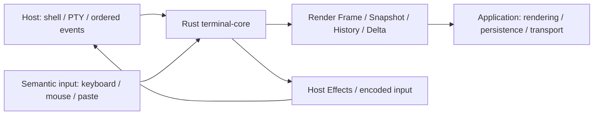

# TermLink Terminal Core

[简体中文](README.md) · **English**

TermLink's Rust terminal state engine provides terminal parsing, state recovery, render data, and input encoding through a C ABI and Android JNI.

It is maintained independently of the [TermLink application](https://github.com/myucxy/TermLink). The host owns the shell, PTY/ConPTY, window rendering, networking, and system permissions. The core turns ordered terminal events into deterministic state and output.

Project-owned code uses **[GPL-3.0-only](LICENSE)**. Third-party material retains its own terms and attribution; see [NOTICE](NOTICE).

[Quick start](#quick-start) · [Integration and builds](#integration-and-builds) · [Compatibility and safety](#compatibility-and-safety) · [Documentation](#documentation)

## Core capabilities

| Area | Available in the current code |
| --- | --- |
| Terminal state | Primary and alternate screens, cursor, colors and attributes, scroll regions, soft wrapping, resize, and bounded scrollback |
| Text and input | UTF-8, CJK/emoji width, an explicit Unicode 16 grapheme profile; keyboard, mouse, paste, focus, and Kitty keyboard encoding |
| State exchange | Profile-selected Snapshot V2.0–V2.22, Render Frame V1–V5, and ordered Host Effects |
| History and recovery | Frozen history captures, History Page, checkpoints, and versioned State Delta APIs with base validation |
| Graphics and glyphs | DRCS, SIXEL, supported Kitty graphics subsets, and bounded shared resources and placement state under explicit graphics profiles |
| Diagnostics and bindings | Stable status codes, structured protocol/input diagnostics, C ABI, Android JNI, and host capability/structure-size queries |

This is a summary of code capabilities. Profiles select semantics, resource budgets, and export versions; a session does not automatically enable every feature. Graphics, remote history, and system interaction also require the host, bindings, renderer, and transport to work together.

Windows and Android use the native core. **Core tests, cross-target compilation, and product acceptance are separate evidence levels.** This README does not claim complete VT/xterm compatibility, every Kitty extension, or production support on every platform. Consult the [integration records](INTEGRATION_STATUS_20261010.md) and [product acceptance matrix](PRODUCT_ACCEPTANCE_MATRIX_20261010.md) for batch-specific evidence and remaining gates. Older records retain their historical context.

## Architecture and responsibilities



The core does not launch processes, connect to model services, manage accounts or Relay, or directly perform clipboard, file, or notification operations. Host Effects are data for the host to validate and execute; recovery and mirror replay must not repeat live side effects. A restricted host broker handles graphics file and shared-memory access.

The application's current CLI / AI integration testing scope is **Relay Only**. Network policy and end-to-end encryption belong to the application layer.

## Quick start

Run commands from this repository root. Core tests do not require an application checkout.

### Prepare the tools and run tests

- Rust **1.97.1**, pinned in [rust-toolchain.toml](rust-toolchain.toml), with Rustfmt and Clippy.
- Windows native builds require MSVC and the Windows SDK. Five-library export additionally requires the Android NDK, CMake, Ninja, and the corresponding Rust Android targets.
- On the maintainer's workstation, follow `D:\Dev\DEV_ENV_MANIFEST.json` and `D:\Dev\DEV_ENV_POLICY.md`; check required tools with `D:\Dev\Scripts\Ensure-DevEnv.ps1` before builds. Do not change system PATH automatically.

On a new machine, populate the locked dependency cache before running offline checks:

```powershell
cargo +1.97.1 fetch --locked
cargo +1.97.1 fmt --all -- --check
cargo +1.97.1 clippy --workspace --all-targets --all-features --locked --offline -- -D warnings
cargo +1.97.1 test --workspace --all-targets --all-features --locked --offline
```

The initial `fetch` needs a reachable dependency source; subsequent `--offline` commands require a complete cache. Do not upgrade dependencies or regenerate the lock during release. Repository-owned [golden replay inputs](testdata/terminal-golden-streams/README.md) are included. Tests need neither application source nor model-service credentials.

### Build the Windows native library

```powershell
cargo +1.97.1 build -p termlink-terminal-ffi --release --locked --offline --target x86_64-pc-windows-msvc
```

The DLL is written to `target/x86_64-pc-windows-msvc/release/termlink_terminal_ffi.dll`. Run from the repository root to preserve the Windows static CRT setting in [.cargo/config.toml](.cargo/config.toml). Linux/macOS cross-target checks do not establish runtime or rendering acceptance on those platforms.

## Integration and builds

### Rust, C, and Android

| Entry point | Location and responsibility |
| --- | --- |
| Rust engine | [termlink-terminal-core](crates/termlink-terminal-core/Cargo.toml) |
| Native wrapper | [termlink-terminal-ffi](crates/termlink-terminal-ffi/Cargo.toml), producing `cdylib`, `staticlib`, and `rlib` outputs |
| C API | [include/termlink_terminal.h](include/termlink_terminal.h), defining initialization, versions, sizes, ownership, and release rules |
| Android JNI | [JNI C++](android/jni/termlink_terminal_jni.cpp) and [CMake](android/jni/CMakeLists.txt); Kotlin/C# bindings and views remain in the application repository |

### Export to the TermLink application

On Windows, use a clean, committed core checkout:

```powershell
.\scripts\Build-ToTermLink.ps1

# This must be an application source checkout, not an installed client directory.
.\scripts\Build-ToTermLink.ps1 -TermLinkDirectory ..\termlink
```

The [export script](scripts/Build-ToTermLink.ps1) defaults to pinned tools under `D:\Dev` and accepts path overrides. Its default Android NDK is `27.0.12077973`, targeting API 26. It builds all five libraries before copying them into the application's `native/terminal-core/`:

| Target | Exported file |
| --- | --- |
| Windows x64 | `windows-x64/termlink_terminal_ffi.dll` |
| Android arm64-v8a, armeabi-v7a, x86, x86_64 | `android/<abi>/libtermlink_terminal_jni.so` |

Build caches stay in core `target/`; staged libraries and their manifest stay in `dist/`. The script checks source state before and after the build and verifies copied hashes. It writes the application's `terminal-core.lock.json` last, recording revision, dirty state, toolchain, sizes, and SHA-256 hashes. Commit application libraries and lock together. Application builds validate and consume prebuilt libraries without compiling core.

`-Development` permits local export from uncommitted source, marks `source_dirty=true`, and cannot pass the application's production gate. A documentation-only change must not rewrite an existing binary's actual source revision.

## Compatibility and safety

- **Versions are independent.** The current native ABI is v1. Snapshot, Render Frame, Host Effect, History Page, and Delta have separate versions. Use a selected profile with matching decoders; ABI v1 alone does not imply wire compatibility.
- **Follow structure and memory contracts.** Set `abi_version`, `struct_size`, and reserved fields as defined in the header, and use the appropriate size queries. Leave returned owned buffers unchanged and release them through the same library. Rust panic containment does not recover invalid foreign pointers or allocator OOM.
- **Preserve ordering and atomic application.** Sequence gaps, damaged snapshots, invalid state, and resource exhaustion have explicit errors. Read-only query fallbacks are instruction-specific; unknown state-changing controls are not silently ignored to claim compatibility.
- **Resources are bounded.** A terminal supports up to 512 columns × 512 rows and 262,144 cells. One Output event is limited to 1 MiB. History, graphemes, graphics, snapshots, captures, and Delta have separate budgets; no single limit is a total-session memory guarantee.
- **Distinguish new and reserved entry points.** Use versioned `tl_terminal_checkpoint_export_delta_v1` / `tl_terminal_checkpoint_apply_delta_v1`. The old unversioned `tl_terminal_checkpoint_export_delta` and raw-byte `tl_terminal_encode_input` remain unsupported placeholders.

See the topic contracts below for graphics, frozen history, Delta, themes, and host interaction. A design document or historical test result does not establish that an installed client enables the feature or has passed every scenario.

## Repository layout

| Path | Purpose |
| --- | --- |
| `crates/termlink-terminal-core/` | Deterministic state, parsing, input, history, snapshots, graphics, and Delta |
| `crates/termlink-terminal-ffi/` | C ABI, handles, owned buffers, and error boundary |
| `include/` | Public C header |
| `android/jni/` | JNI C++ and Android CMake build |
| `scripts/` | Five-library export, pinned data generation, and JNI registration checks |
| `testdata/` | Repository-owned golden replay inputs, provenance, and hashes |
| `third_party/` | Unicode, legacy mappings, and Rust dependency provenance and licenses |
| `docs/archive/` | Earlier implementation notes with historical context |

This repository was split from `terminal-core/` at `myucxy/TermLink@78c011b` on October 5, 2026. The application retains its earlier full history. Core source and build logic are maintained here and must not be copied back into the application's source tree.

## Documentation

| Topic | Documents |
| --- | --- |
| Implementation and product gates | [Integration records](INTEGRATION_STATUS_20261010.md), [22-group acceptance matrix](PRODUCT_ACCEPTANCE_MATRIX_20261010.md) |
| Roadmap and original gaps | [Roadmap](DEVELOPMENT_ROADMAP.md), [implementation plan](FULL_CAPABILITY_IMPLEMENTATION_PLAN_20261009.md), [historical gaps and completion criteria](UNIMPLEMENTED_CAPABILITIES.md) |
| C ABI and diagnostics | [Public header](include/termlink_terminal.h), [Input Diagnostic V1](INPUT_DIAGNOSTIC_V1.md) |
| History and incremental recovery | [History Page contract](HISTORY_PAGE_CONTRACT_20261010.md), [remote frozen history](E02_REMOTE_FROZEN_HISTORY_DESIGN_20261010.md), [State Delta](S7_STATE_DELTA_DESIGN_20261010.md) |
| Graphics and broker | [Resource contract](GRAPHICS_RESOURCE_CONTRACT_20261010.md), [graphics implementation](S6_GRAPHICS_IN_PROGRESS_20261010.md), [Windows broker](G01_WINDOWS_BROKER_DESIGN_20261010.md) |
| Text and host state | [Unicode 16](S1_S4_REPORTS_UNICODE_BASELINE_20261009.md), [line renditions](S2_LINE_RENDITIONS_20261009.md), [themes](S2_HOST_THEME_20261010.md), [persistent session profiles](S1_PERSISTENT_SESSION_PROFILE_20261010.md) |
| Dependencies and earlier notes | [Rust dependency provenance](third_party/rust-dependencies/README.md), [previous README implementation notes](docs/archive/README_IMPLEMENTATION_NOTES.md) |

## License and source delivery

Project-owned Rust code, C ABI, JNI, build scripts, and tests use [GPL-3.0-only](LICENSE). Unicode data, legacy mappings, and SHA-256 dependencies retain the licenses and attribution in [NOTICE](NOTICE) and `third_party/`; they are not relicensed as project-owned GPL code.

Binary delivery must provide the complete matching source, pinned dependencies, and build materials as required by GPLv3. A private or inaccessible repository URL is not a substitute. Licensing, remote visibility, and release are separate actions; this README does not assert that the repository is public or that artifacts have passed release acceptance.
