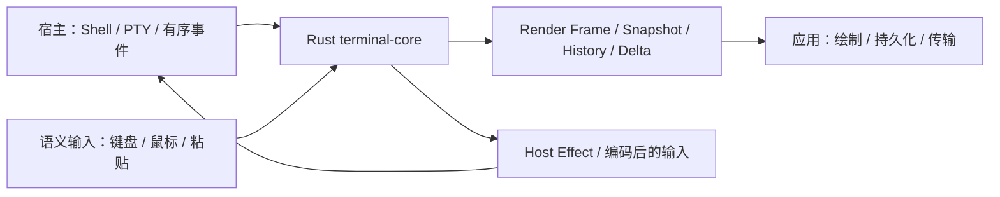

# TermLink Terminal Core

**简体中文** · [English](README.en.md)

TermLink 自研的跨平台终端状态引擎，使用 Rust 实现，通过 C ABI 和 Android JNI 提供终端解析、状态恢复、渲染数据与输入编码能力。

本仓库独立于 [TermLink 应用](https://github.com/myucxy/TermLink)维护。Shell、PTY/ConPTY、窗口绘制、网络传输和系统权限由应用宿主管理；core 负责让同一份有序终端事件产生确定性的状态与输出。

自有代码采用 **[GPL-3.0-only](LICENSE)**，第三方材料保留原许可与署名，详见 [NOTICE](NOTICE)。

[快速开始](#快速开始) · [集成与构建](#集成与构建) · [兼容与安全边界](#兼容与安全边界) · [文档导航](#文档导航)

## 核心能力

| 范围 | 当前代码提供的能力 |
| --- | --- |
| 终端状态 | 主屏与备用屏、光标、颜色与样式、滚动区域、软换行、窗口调整和有界回滚历史 |
| 文本与输入 | UTF-8、CJK/emoji 字宽、显式 Unicode 16 字素 profile；键盘、鼠标、粘贴、焦点及 Kitty keyboard 编码 |
| 状态交换 | 按 profile 选择的 Snapshot V2.0–V2.22、Render Frame V1–V5，以及有序 Host Effect |
| 历史与恢复 | 冻结历史捕获、History Page、checkpoint，以及带基准校验的版本化 State Delta API |
| 图形与字形 | 显式图形 profile 下的 DRCS、SIXEL、受支持的 Kitty graphics 子集，以及有界共享资源与 placement 状态 |
| 诊断与绑定 | 稳定状态码、结构化协议/输入诊断、C ABI、Android JNI，以及宿主能力与结构尺寸查询 |

这是代码能力概览。Profile 决定具体语义、资源预算和可导出的版本，并非每个会话都会启用全部能力。图形、远端历史和系统交互还需要宿主、绑定、渲染器和传输共同接入。

Windows 与 Android 已接入 native core。**核心测试、跨目标编译和产品验收是不同层级**；这里不宣称完整 VT/xterm 兼容、全部 Kitty 扩展或所有平台的生产支持。各批次证据与剩余门禁见[整合状态](INTEGRATION_STATUS_20261010.md)和[产品验收矩阵](PRODUCT_ACCEPTANCE_MATRIX_20261010.md)，日期较早的记录保留当时状态。

## 架构与职责



core 不启动进程、不连接模型服务、不管理账号或 Relay，也不直接执行剪贴板、文件或通知操作。Host Effect 是交给宿主校验和执行的数据；恢复或镜像回放不应重复执行实时副作用。图形文件与共享内存访问由受限宿主 broker 处理。

当前应用 CLI / AI 联测范围为 **Relay Only**，网络策略与端到端加密属于应用层。

## 快速开始

在本仓库根目录运行命令，无需同时检出应用仓库即可测试 core。

### 准备工具与运行测试

- Rust **1.97.1**，固定于 [rust-toolchain.toml](rust-toolchain.toml)，包含 Rustfmt 和 Clippy。
- Windows 原生库需要 MSVC 工具链及 Windows SDK；五库导出还需要 Android NDK、CMake、Ninja 和对应 Rust Android targets。
- 本机开发遵循 `D:\Dev\DEV_ENV_MANIFEST.json` 与 `D:\Dev\DEV_ENV_POLICY.md`；构建前用 `D:\Dev\Scripts\Ensure-DevEnv.ps1` 检查所需工具，不自动修改系统 PATH。

新环境先准备锁定的依赖缓存，再离线检查与测试：

```powershell
cargo +1.97.1 fetch --locked
cargo +1.97.1 fmt --all -- --check
cargo +1.97.1 clippy --workspace --all-targets --all-features --locked --offline -- -D warnings
cargo +1.97.1 test --workspace --all-targets --all-features --locked --offline
```

首次 `fetch` 需要可用的依赖源，之后的 `--offline` 命令要求缓存齐全。不要在发布时临时升级依赖或重新生成锁文件。仓库内含自有 [golden 回放输入](testdata/terminal-golden-streams/README.md)，测试无需应用源码、模型服务或登录凭据。

### 构建 Windows 原生库

```powershell
cargo +1.97.1 build -p termlink-terminal-ffi --release --locked --offline --target x86_64-pc-windows-msvc
```

DLL 位于 `target/x86_64-pc-windows-msvc/release/termlink_terminal_ffi.dll`。从仓库根运行以保留 [.cargo/config.toml](.cargo/config.toml) 的 Windows 静态 CRT 设置。Linux/macOS 的跨目标编译检查不能代替对应平台的运行与渲染验收。

## 集成与构建

### Rust、C 与 Android

| 入口 | 位置与职责 |
| --- | --- |
| Rust 引擎 | [termlink-terminal-core](crates/termlink-terminal-core/Cargo.toml) |
| 原生库封装 | [termlink-terminal-ffi](crates/termlink-terminal-ffi/Cargo.toml)，生成 `cdylib`、`staticlib` 与 `rlib` |
| C API | [include/termlink_terminal.h](include/termlink_terminal.h)，定义初始化、版本、尺寸、所有权与释放规则 |
| Android JNI | [JNI C++](android/jni/termlink_terminal_jni.cpp) 与 [CMake](android/jni/CMakeLists.txt)；Kotlin/C# 绑定与 View 留在应用仓库 |

### 导出到 TermLink 应用

在 Windows 上，使用已提交且干净的 core 工作区运行：

```powershell
.\scripts\Build-ToTermLink.ps1

# 应用源码目录可显式指定，不能指向已安装的客户端目录。
.\scripts\Build-ToTermLink.ps1 -TermLinkDirectory ..\termlink
```

[导出脚本](scripts/Build-ToTermLink.ps1)默认使用本机 `D:\Dev` 固定工具路径，可通过参数覆盖。Android NDK 默认版本为 `27.0.12077973`，构建使用 API 26。脚本先构建全部五个库，再复制到应用的 `native/terminal-core/`：

| 目标 | 导出文件 |
| --- | --- |
| Windows x64 | `windows-x64/termlink_terminal_ffi.dll` |
| Android arm64-v8a、armeabi-v7a、x86、x86_64 | `android/<abi>/libtermlink_terminal_jni.so` |

构建缓存留在 core 的 `target/`，暂存产物与清单留在 `dist/`。脚本核验构建前后源码状态与复制后哈希，最后写入应用的 `terminal-core.lock.json`，记录 revision、dirty 状态、工具链、文件大小与 SHA-256。应用中的库和锁文件应一起提交；应用构建只校验并消费预编译库，不编译 core。

`-Development` 允许未提交源码导出本地开发库，但清单会标记 `source_dirty=true`，不能通过应用的正式发布门禁。纯文档修改也不应改写既有二进制实际对应的源码 revision。

## 兼容与安全边界

- **版本分别管理。** 当前原生 ABI 为 v1；Snapshot、Render Frame、Host Effect、History Page 和 Delta 有独立版本。使用所选 profile 与匹配的解码器，不能仅凭 ABI v1 推断所有协议兼容。
- **结构与内存按契约传递。** 按头文件填写 `abi_version`、`struct_size` 和 reserved 字段，并使用相应尺寸查询。库返回的 owned buffer 应保持不变，由同一库的释放函数回收；Rust panic 防护不能修复非法外部指针或分配器 OOM。
- **保留事件顺序与原子性。** 缺序、损坏快照、非法状态和资源超限有明确错误；只读查询的兼容回退按具体指令定义，不以静默忽略未知状态指令换取“兼容”。
- **资源有界。** 终端最大为 512 列 × 512 行，总计 262,144 cells；单次 Output 最多 1 MiB。历史、字素、图形、快照、捕获和 Delta 各有独立预算，不能把其中一个上限当作整个会话的内存保证。
- **新旧入口不混用。** 使用版本化 `tl_terminal_checkpoint_export_delta_v1` / `tl_terminal_checkpoint_apply_delta_v1`；旧的无版本 `tl_terminal_checkpoint_export_delta` 和 raw-byte `tl_terminal_encode_input` 仍是 unsupported 预留入口。

图形、冻结历史、Delta、主题与宿主交互的细节见下面的专题契约。设计文档和历史测试通过不等于当前安装包已启用或全部场景已验收。

## 仓库结构

| 路径 | 内容 |
| --- | --- |
| `crates/termlink-terminal-core/` | 确定性状态、解析、输入、历史、快照、图形与 Delta |
| `crates/termlink-terminal-ffi/` | C ABI、句柄、owned buffer 与错误边界 |
| `include/` | 公共 C 头文件 |
| `android/jni/` | JNI C++ 与 Android CMake 构建 |
| `scripts/` | 五库构建导出、固定数据生成与 JNI 注册检查 |
| `testdata/` | 自有 golden 回放输入与来源、哈希记录 |
| `third_party/` | Unicode、旧字符映射与 Rust 依赖的来源及许可 |
| `docs/archive/` | 保留历史阶段语境的旧实现说明 |

仓库于 2026-10-05 从 `myucxy/TermLink@78c011b` 的 `terminal-core/` 拆分，应用保留此前完整历史。核心源码与编译逻辑在本仓库独立维护，不回拷到应用源码目录。

## 文档导航

| 主题 | 文档 |
| --- | --- |
| 实施状态与产品门禁 | [整合状态](INTEGRATION_STATUS_20261010.md)、[22 组产品验收矩阵](PRODUCT_ACCEPTANCE_MATRIX_20261010.md) |
| 路线与原始缺口 | [开发路线图](DEVELOPMENT_ROADMAP.md)、[全量实施计划](FULL_CAPABILITY_IMPLEMENTATION_PLAN_20261009.md)、[缺口历史与完成标准](UNIMPLEMENTED_CAPABILITIES.md) |
| C ABI 与诊断 | [公共头文件](include/termlink_terminal.h)、[输入诊断 V1](INPUT_DIAGNOSTIC_V1.md) |
| 历史与增量恢复 | [History Page 契约](HISTORY_PAGE_CONTRACT_20261010.md)、[冻结历史](E02_REMOTE_FROZEN_HISTORY_DESIGN_20261010.md)、[State Delta](S7_STATE_DELTA_DESIGN_20261010.md) |
| 图形与 broker | [资源契约](GRAPHICS_RESOURCE_CONTRACT_20261010.md)、[图形实现记录](S6_GRAPHICS_IN_PROGRESS_20261010.md)、[Windows broker](G01_WINDOWS_BROKER_DESIGN_20261010.md) |
| 文本与宿主状态 | [Unicode 16](S1_S4_REPORTS_UNICODE_BASELINE_20261009.md)、[行属性](S2_LINE_RENDITIONS_20261009.md)、[主题](S2_HOST_THEME_20261010.md)、[持久会话 profile](S1_PERSISTENT_SESSION_PROFILE_20261010.md) |
| 依赖与历史说明 | [Rust 依赖来源](third_party/rust-dependencies/README.md)、[旧 README 实现说明](docs/archive/README_IMPLEMENTATION_NOTES.md) |

## 许可与源码交付

自有 Rust、C ABI、JNI、构建脚本和测试采用 [GPL-3.0-only](LICENSE)。Unicode 数据、旧字符映射与 SHA-256 依赖的原许可及署名见 [NOTICE](NOTICE) 与 `third_party/`，不将这些材料重新声明为自有 GPL 代码。

二进制交付按 GPLv3 要求提供与产物对应的完整源码、锁定依赖和构建资料；私有或不可访问的仓库链接不能代替源码交付。许可证声明、远端可见性与正式发布是独立事项，本 README 不表示仓库已公开或制品已完成发布验收。
